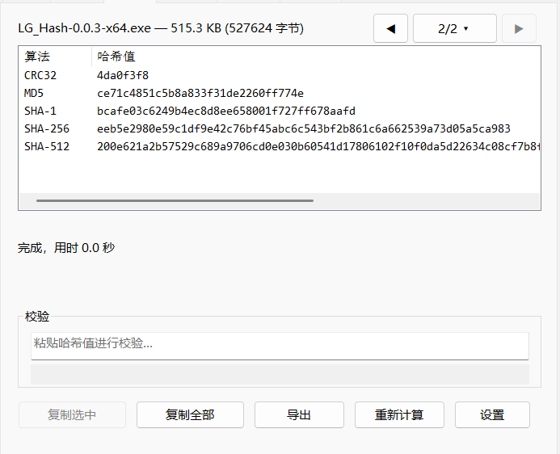

# LG_Hash

Windows 资源管理器 Shell 属性页扩展：右键文件 → 属性 → 「哈希」页，计算文件哈希。

## 功能

- **五种算法**：CRC32 / MD5 / SHA-1 / SHA-256 / SHA-512，1 MiB 分块单遍读盘
- **按需计算**：切到「哈希」页才读盘，停在其它页不产生 IO
- **粘贴校验**：输入外部哈希实时比对，忽略空白、不区分大小写
- **复制与导出**：双击行或 `Ctrl+C` 复制；可另存 `*.SUMS.txt`（UTF-8 无 BOM、CRLF）
- **多选**：最多 64 个文件串行计算，用「◀ i/N ▾ ▶」切换查看
- **算法可裁剪**：在设置里取消勾选的算法直接从列表移除，重新勾选无需重算
- **变更检测**：计算前后比对大小 / LastWrite / NTFS ChangeTime / 文件 ID，被改动则警告
- **深色模式**：跟随系统，菜单与对话框全部自绘适配
- **中英双语**：跟随系统语言，可用 `LangId` 强制指定

## 安装

| 命令 | 作用 |
|------|------|
| `LG_Hash.exe` | 安装到 `%LOCALAPPDATA%\LG_Hash` 并注册（HKCU，无需管理员） |
| `LG_Hash.exe /quiet`（或 `/s`） | 静默安装 |
| `LG_Hash.exe /uninstall` | 卸载（也可在「设置 → 应用和功能」触发） |
| `LG_Hash.exe /uninstall /quiet` | 静默卸载 |
| `LG_Hash.exe /help` | 列出全部参数 |

安装后重启 `explorer.exe`，右键任意文件 → 属性 → 「哈希」页即可使用。

## 配置

| 项 | 位置 |
|----|------|
| 算法勾选 / 大写显示 / 语言 | `HKCU\Software\LG_Hash` |
| 主题覆盖 | `HKCU\Software\LG_Hash\Theme`（1=浅色 2=深色） |
| 安装目录 | `%LOCALAPPDATA%\LG_Hash` |

配置修改后**下次打开属性页即生效**，不需要重启 `explorer.exe`。

## 技术栈

C++17 / Win32 裸 API，无第三方依赖；Windows CNG（BCrypt）多算法哈希，计算在后台线程，UI 线程零阻塞。静态 CRT（`/MT`），目标机无需安装 VC++ 运行库。

## 从源码构建

源码仓库另含 `BUILDING.md`，说明编译、测试、签名与打包的完整流程。
